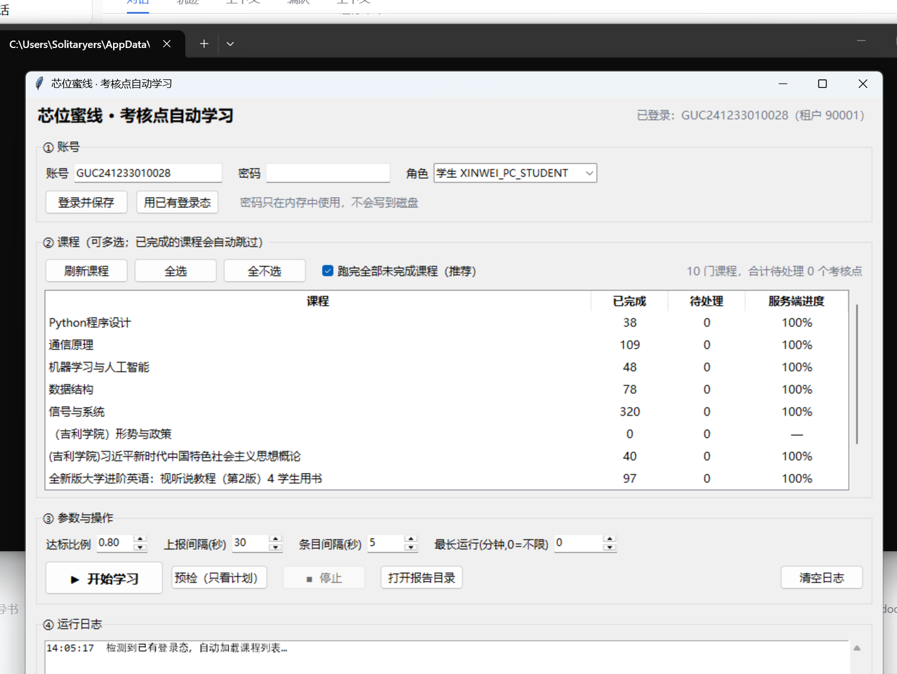

# 芯位蜜线 · 考核点自动学习

[](LICENSE)
[](https://www.python.org/)
[](#)
[](#)

一个**纯 HTTP** 的课程学习助手：不驱动浏览器、不伪造数据，只把「守在页面前等视频播完」这件事自动化。
带 Windows 图形界面，填上账号密码点一下就能跑；账号密码不落盘，跑完自动出报告。

> **⚠️ 免责声明（请先读）**
> 本项目仅供**个人学习与技术研究**（HTTP 接口分析、异步任务调度、GUI 编程）使用。
> 使用本项目可能违反你所在学校 / 平台的服务条款，**由此产生的一切后果由使用者自行承担**。
> 请勿用于刷课牟利、代学代考、批量代刷等场景；请优先遵守学校的课程学习规定。
> 项目不含任何平台账号、密码或登录态；接口随时可能变更，维护者不保证长期可用。

---

## 它长什么样



## 特性

| | |
|---|---|
| **纯 HTTP** | 不装浏览器、不用 Playwright/Selenium，只用 Python 标准库 `urllib`。内存占用小，可挂后台 |
| **图形界面** | Tkinter 单文件 GUI：填账号密码 → 选课程 → 开始 / 随时停止，实时看每个考核点的进度 |
| **断点续跑** | 进度与「已看到第几秒」原子写进 `.beeline/progress.json`，随时 Ctrl+C / 点停止，下次从断点接着学 |
| **自动续期** | 平台 token 实测约 30 分钟过期，工具自动用密码重登，长跑不中断 |
| **瞬时错误重试** | 5xx / 网关抖动 / 网络超时按 2/4/8/16 秒退避重试；风控错误不重试（越重试越脏） |
| **已完成的自动跳过** | 每门课先读服务端章节树，完成的直接跳过；跑完一门自动换下一门 |
| **不越线** | 作业 / 测验 / 考试类考核点**不自动提交**（避免影响成绩），只记成「需人工」并在日志里点名 |
| **零依赖** | 不需要 `pip install` 任何东西，Windows + Python 3.10+ 即可 |

## 获取

```powershell
git clone https://github.com/Solitaryers/beeline-auto-study.git
cd beeline-auto-study
```

不需要 `pip install`：本工具只用 Python 标准库（`urllib` + `tkinter`），Windows + Python 3.10+ 即可运行。

## 快速开始

```powershell
# 方式一：图形界面（推荐）
双击  启动界面.bat

# 方式二：命令行
python beeline_study.py login --user <你的账号>       # 登录并保存登录态
python beeline_study.py points --course Python程序设计  # 看考核点与完成情况（只读）
python beeline_study.py run    --course Python程序设计  # 开跑
python beeline_study.py run    --all --gap 5           # 全部课程排队，一门一门跑
```

界面里四块：**① 账号**（账号 / 密码 / 角色）、**② 课程**（已完成 / 待处理 / 服务端进度，可多选）、
**③ 参数与操作**（达标比例、上报间隔、最长运行分钟、开始 / 预检 / 停止）、**④ 运行日志**（逐条实时进度）。

## 它是怎么工作的

审计了站点两套前端（旧 SPA 的 751 个 chunk + 新学生端的 370 个 chunk）之后确认：
真正决定「视频类考核点是否完成」的只有一个接口——

```
POST /api/learning-service/admin/studentLearning/videoLearnProcessReport
```

学生端播放器每累计 30 秒播放时间调用它一次，服务端据此累加 `learnProcessInfo.studyTime`；
当 `studyTime ≥ videoRule`（学校设的达标比例，本项目实测为 80%）时，
`getChapterData` 里该条目 `status` 变为 `2`，课程页那个 `14/38` 的分子 +1。

所以本工具的循环就是：

```
enterClass → 每 30 秒：心跳(saasUserDurationInfo/save) → 上报(start,end)=（上一秒, 这一秒）
          → 读回 studyTime → 达标即下一个条目
```

### 服务端的三道反作弊（已实测，也是本工具「不加速」的原因）

| 尝试 | 服务端响应 |
|---|---|
| 30 秒内把进度从 30 秒跳到 748 秒 | `code=500 系统检测到你的学习状态异常，请刷新后继续学习` |
| 心跳 120 秒后一次报 0→120 | `code=500 播放位置不合法` |
| 同时学两个条目 | `code=500 同时只可学习一门课程` |
| 隔 33 秒 → 心跳 → 报 30→60（正常节奏） | `code=200`，`studyTime` 30→60 ✅ |

**结论：进度最多按真实时间 1:1 推进。** 本工具省掉的是「人必须坐在屏幕前」，不是「学习时长」本身。
任何声称能秒刷的实现，要么是假的，要么在你不知道的时候把账号刷进了风控名单。

## 命令行速查

| 命令 | 作用 |
|---|---|
| `login` | 登录并保存登录态（密码不回显，也可用 `BEELINE_PASS` 环境变量） |
| `courses` | 列出我的课程 |
| `points --course <课>` / `--all` | 列出考核点与完成情况（只读，不产生任何写入） |
| `run --course <课>` | 开跑一门课 |
| `run --all --gap 5` | 全部课程排队跑 |
| `run --all --stop-at 07:00` | 排到早上 7 点自动收工（也可 `--max-minutes 180`） |
| `run ... --dry-run` | 只算预计耗时，不上报 |
| `status` | 看本地存档 |

常用参数：`--threshold 0.8`（达标比例）、`--interval 30`（上报间隔）、`--gap 5`（条目间隔）、
`--max-items N`、`--only <关键词>`。完整说明见 [使用说明.md](使用说明.md)。

## 项目结构

```
beeline_gui.py      图形界面（Tkinter，单文件）
beeline_study.py    学习运行器 + 命令行（登录 / 课程 / 考核点 / 运行 / 存档）
beeline_api.py      HTTP 客户端（登录、token 续期、5xx 重试、退避、反作弊错误识别）
使用说明.md          详细文档（接口表、反作弊实测原始记录、全部参数、常见问题）
docs/界面截图.png    界面截图
legacy/browser-playwright/  早期用 Playwright 驱动浏览器的版本（未针对真实站点校准，仅供研究）
启动界面.bat         双击启动界面（自动切 UTF-8 代码页，避免中文日志乱码）
```

运行产物都在 `.beeline/`（已被 `.gitignore` 排除）：`token.json`（登录态）、`progress.json`（断点）、
`logs/`（按天日志）、`reports/`（每次运行的小结 JSON）。

## 常见问题

**Q：会不会被判定作弊？**
A：工具严格按真实时间推进、串行上报、带心跳，不做跳跃。但**任何自动化都可能违反平台规定**，风险请自行评估，建议仅在允许的范围内使用。

**Q：为什么作业 / 测验不动？**
A：这些会算成绩，自动提交风险太高。工具只在日志里标「需人工」，让你自己去点。

**Q：token 老是过期？**
A：平台 token 实测 30 分钟。界面里填了密码就会自动重登；命令行请用 `$env:BEELINE_PASS`，否则过期会停下并提示重新 `login`。

**Q：跑一半关掉会怎样？**
A：进度每步都原子落盘，下次启动自动跳过已完成的、从断点秒数接着学。实测 kill -9 也不会写坏存档。

**Q：接口变了怎么办？**
A：`legacy/browser-playwright/api_probe.py` 是只读探针（`whoami` / `courses` / `course <id>` / `raw GET <path>`），
在那个目录里运行就能快速验证接口是否还有效。

## 开发笔记（想复刻的话）

1. 平台是 Nuxt SPA + 一套更新的学生端（`/student/`），所有接口同源在 `/api/<微服务>/...`，统一信封 `{code,msg,data}`。
2. 登录**不需要验证码**（`POST /api/xinwei-auth/oauth2/token`，query 传参，`platform_type=XINWEI_PC_STUDENT`、`type=SSO`）；
   用错角色会返回 `code=500 该账号无此角色权限`——很多教程卡在这一步。
3. 老学习页（`/learning/student/studentIndex.action`）在这类已迁移租户上会被关闭（`操作失败，无法进入课程`），
   新入口是 `/student/#/courseInfo/learn/courseWare/<id>`。
4. 「进度到底打哪个接口」这件事，在页面 DOM 层完全找不到答案（`timeupdate` 在全部 chunk 里 0 命中），
   最后是从播放器组件的 `setInterval` 里顺着 import 映射挖出来的。

## 许可

[MIT](LICENSE)。再次提醒：**仅供学习研究，后果自负**。
