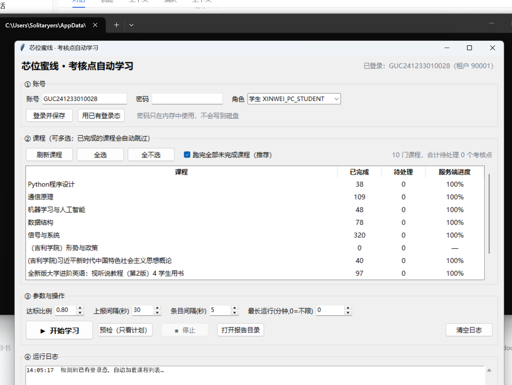

# 芯位蜜线 · 考核点自动学习（纯 HTTP 版）

> 图形界面：双击 `启动界面.bat`（或 `python beeline_gui.py`）——填账号密码，点「开始学习」。
> 命令行：`python beeline_study.py login --user <账号>` → `points --course <课程>` → `run --course <课程>`
> 不驱动浏览器、不做假数据，只是把"守在页面前等视频播完"这件事自动化。

---

## 〇、图形界面（最省事）

不想敲命令就用界面：

```powershell
.\启动界面.bat            # 或者：python beeline_gui.py
```



界面分四块：

| 区域 | 做什么 |
| --- | --- |
| ① 账号 | 填账号 + 密码 → 选角色（学生 / 教师 / 管理者）→「登录并保存」。密码只在内存里用来续期，**不写任何文件**；登录态存 `.beeline/token.json`，下次开界面自动载入课程列表 |
| ② 课程 | 每门课显示 已完成 / 待处理 / 服务端进度；可多选，也可以勾「跑完全部未完成课程」 |
| ③ 参数与操作 | 达标比例（默认 0.80）、上报间隔（默认 30 秒）、条目间隔、最长运行分钟；「开始学习」「预检（只看计划）」「■ 停止」 |
| ④ 运行日志 | 实时显示每个考核点的进度，例如 `已看 3m30s / 12m20s（28.3%）  还差 8m50s` |

几个要点：

- **停止立刻生效**：点「■ 停止」后，当前这一小步上报（≤30 秒）结束就停，已看秒数立刻写进存档，下次从这个点接着学。
- **token 自动续期**：界面里填的密码会留在内存里，30 分钟过期时自动重新登录，不用管。
- **作业 / 测验 / 考试**这类考核点不会自动提交（避免影响成绩），记成"需人工"并在日志里点名。
- 跑完弹窗汇总，并自动刷新课程列表；报告落在 `.beeline\reports\gui-<时间>.json`。
- 自检（不需要人操作）：`python beeline_gui.py --selftest`（建好界面 → 1.2 秒后自动关闭）。
- 界面和命令行**共用同一份存档**（`.beeline\progress.json`），两种方式可以混着用。

---

## 一、它凭什么能完成考核点

审计了站点两套前端（旧 SPA `/_nuxt/` 与新学生端 `/student/`）的全部 JS 后确认：
真正决定"视频类考核点是否完成"的只有一个接口——

```
POST /api/learning-service/admin/studentLearning/videoLearnProcessReport
```

学生端播放器（`index-BVoanh5B.js` 的 `Ve()`）每累计 30 秒播放时间调用它一次，服务端据此累加
`learnProcessInfo.studyTime`，达到该条目的 `videoRule`（本课程 = 80%）后把 `completeStatus` 置为 `"2"`，
`isExamine=1` 的"章节考核点完成数"+1（也就是页面上那个 `14/38`）。

配套接口（都在 `beeline_api.py` 里）：

| 用途 | 接口 |
| --- | --- |
| 登录（无验证码） | `POST /api/xinwei-auth/oauth2/token`（query 传参，`platform_type=XINWEI_PC_STUDENT`, `type=SSO`） |
| 我的账号 | `GET /api/xinwei-auth/user/profile` |
| 我的课程 | `POST /api/learning-service/student/course/queryLearnCourseListAndCount` |
| 进入教学班（建立学习会话） | `POST /api/learning-service/manager/collect/teachingClass/enterClass` |
| 心跳（在班信用，须复用同一 callBackId） | `POST /api/learning-service/manager/saasUserDurationInfo/save` |
| 考核点树（含 status/studyTime/totalTime/textType） | `POST /api/learning-service/admin/studentLearning/getChapterData` |
| 单条目详情（videoLength/videoRule/已看秒数） | `POST /api/learning-service/admin/studentLearning/getSingleChapterData/{itemId}` |
| **上报观看进度** | `POST /api/learning-service/admin/studentLearning/videoLearnProcessReport` |
| 文档类上报 | `POST /api/learning-service/admin/studentLearning/documentLearnProcessReport` |
| 考核点汇总 | `POST /api/learning-service/admin/studentLearning/getExamineData` |
| 班级视频策略 | `POST /api/learning-service/teaching/space/config/queryClassVideoConfig`（入参是数组） |

### 服务端的三道反作弊（都已实测）

| 行为 | 服务端响应 |
| --- | --- |
| 30 秒内把进度从 30 秒跳到 748 秒 | `code=500 系统检测到你的学习状态异常，请刷新后继续学习` |
| 单次位移过大（如心跳 120 秒后一次报 0→120） | `code=500 播放位置不合法` |
| 同时学两个条目 | `code=500 同时只可学习一门课程` |
| 隔 33 秒 → 心跳 → 报 30→60（正常节奏） | `code=200 操作成功`，`studyTime` 30→60 ✅ |

**结论：进度最多按真实时间 1:1 推进**，必须有近期心跳，且同一时刻只能学一节。
所以本工具**不加速、不跳播、不并发**——它省掉的只是"你必须坐在屏幕前"。

### 端到端实测记录（2026-10-16）

| 项 | 结果 |
| --- | --- |
| 考核点 `4.3.1【项目实战一】序列之易位同构`（6 分 52 秒） | 从 0 秒推到服务端标记完成，课程考核点 **14/38 → 15/38** ✅ |
| 上报节奏 | 每 33 秒一步（30 秒位移 + 3 秒余量），全程 `code=200`，零失败 |
| 服务端记账 | 我们上报到 300 秒时，服务端已记到 **405 秒**（在班心跳也计入），所以实际比"上报量"更快完成 |
| 反作弊验证 | 743 秒跳跃 / 120 秒单步 → 均被 `500` 拒绝；串行 30 秒步长 → 全部通过 |

---

## 二、快速开始

```powershell
# 0) 依赖：零第三方包（只用 Python 标准库 urllib）
python --version            # 需要 3.10+

# 1) 登录（密码不回显；也可用环境变量 BEELINE_PASS 传）
python beeline_study.py login --user <你的账号GUCxxxxxxxxxxxx>

# 2) 看课程列表
python beeline_study.py courses

# 3) 看某门课的考核点与完成情况（只读，安全）
python beeline_study.py points --course Python程序设计

# 4) 先算算要花多久，不上报
python beeline_study.py run --course Python程序设计 --dry-run

# 5) 正式开跑（可随时 Ctrl+C，下次自动续跑）
#    强烈建议先用 BEELINE_PASS 把密码交给进程，这样 token 过期能自动续期
$env:BEELINE_PASS = "你的密码"
python beeline_study.py run --course Python程序设计

# 6) 多门课程排队（一次挂上，按顺序一门一门跑，跑完自动出总表）
python beeline_study.py run -c "Python程序设计,数据结构" -c 信号与系统

# 7) 全部课程排队 + 到点自动收工（例如跑到第二天 7:00 就停）
python beeline_study.py run --all --stop-at 07:00
python beeline_study.py run --all --max-minutes 180      # 或者"最多跑 3 小时"
```

> **token 约 30 分钟就过期**（接口回报 `expires_in=86399`，但实测 30 分钟后就返回
> `code=406 token已经过期`）。所以长跑必须让工具能自己续期：工具会先试 `refresh_token`，
> 失败再用账号密码重新登录——密码来自 `--password` 或环境变量 `BEELINE_PASS`。
> 两个都没有时，token 一过期就会停下并提示你重新 `login`。
> 实测：`refresh_token` 在这个站点不可用（服务端要 `password` 字段），所以实际走的是账号密码重登，
> 中断时间 < 1 秒，进度不丢。

`--course` 接受课程名片段或班级 ID，**可重复给多次或用逗号分隔**；有多门匹配时会列出来让你写精确一点。
一门课跑完会接着跑下一门，每门课各自断点续跑（存档按 `classId` 分开）。

### run 的常用参数

| 参数 | 默认 | 说明 |
| --- | --- | --- |
| `--course/-c` | 必填 | 课程名片段或 `classId`；**可重复 / 逗号分隔**，按顺序排队跑 |
| `--all` | 关 | 跑课程列表里的全部课程 |
| `--stop-at` | 空 | 到 `HH:MM` 就收工（已过则理解为明天）；**当前条目会做完**，不会半途丢进度 |
| `--max-minutes` | `0` | 最多跑这么多分钟就收工（和 `--stop-at` 取更早的那个） |
| `--threshold/-t` | `0` | `0` = 用服务端 `videoRule`（本课程 80%）；也可写 `0.9` |
| `--interval` | `30` | 上报步长（秒）。服务端节奏就是 30，**不建议改大** |
| `--margin` | `3` | 每步额外等待，保证真实经过时间 ≥ 上报位移 |
| `--rate` | `1.0` | 播放倍速。**服务端会核，`>1` 有被判异常的风险，默认别动** |
| `--max-items` | `0` | 本次每门课最多处理几个考核点（0 = 全部） |
| `--only` | 空 | 只处理指定 `itemId` 或用逗号分隔的标题 |
| `--max-failures` | `3` | 单个条目连续被拒多少次就放弃并记录原因 |
| `--doc-mode` | `auto` | 文档类的处理方式：`auto`/`report`/`visit`/`skip` |
| `--gap` / `--no-gap` | `8` | 两个考核点之间的间隔秒数 |
| `--dry-run` | 关 | 只打印计划与预计耗时，不上报 |

日志里每步都会写"已看 X / Y（百分比） 用时 Z **还差 W**"，W 就是这条视频还要多久才能达标。
作业/测验/考试类考核点会记为 **需人工**（`status=manual`），不会算失败，也不会自动提交。

跑完（或到点收工）会打印一张总表，并在 `.beeline/reports/study-run-<时间>.json` 留下完整报告。

---

## 三、时间成本（重要心理预期）

Python程序设计实测：**38 个考核点，已完成 14，剩 24 个全是视频**，
剩余视频按 80% 计约 **14,200 秒 ≈ 3 小时 53 分**——这是**真实时间下限**，因为服务端只认 1:1。
其它课程同理（`points` 命令会自动算给你看）。

建议：

* 让它在后台跑（`python beeline_study.py run -c Python程序设计 *> run.log`），别盯着；
* 跑的过程中**不要**在同一账号上打开学习页面，否则会互相触发"同时只可学习一门课程"；
* 中途 Ctrl+C 完全没问题，进度存在 `.beeline/progress.json`，已完成的条目下次自动跳过。

---

## 四、产物与断点续跑

| 路径 | 内容 |
| --- | --- |
| `.beeline/token.json` | 登录 token（24 小时有效，过期重新 `login`） |
| `.beeline/progress.json` | 每个考核点的状态：`done`/`skipped`/`failed`/`pending` + 原因 + 已推进秒数 |
| `.beeline/logs/study-YYYYMMDD.log` | 运行日志 |
| `.beeline/reports/study-*.json` | 每次运行的小结报告（含服务端 `14/38` 这类口径） |

```powershell
python beeline_study.py status     # 看登录态与进度存档
```

---

## 五、遇到问题怎么办

| 现象 | 原因与处理 |
| --- | --- |
| `code=406 token已经过期` | 站点 token 实测约 30–33 分钟失效（接口回报的 `expires_in=86399` 是假的）。设了 `$env:BEELINE_PASS` 的话工具会自动重新登录并**原样重发本次请求**，日志里会打印"登录态过期，已用账号密码自动重新登录"（已实测：14:22 过期，仅 0.3 秒后继续上报，进度无损失）。没设密码就会把当前考核点记为失败并继续下一个。**注意：`refresh_token` 续期在该站点不可用**——服务端对 `grant_type=refresh_token` 报 `{"code":400,"msg":"不能空","data":"password"}`，所以自动续期实际走的是账号密码。 |
| `code=500 系统检测到你的学习状态异常` | 该条目/会话被写脏了（通常是上一次位移不合规留下的）。工具会退避重试；连续 3 次失败就跳过并记进报告。**恢复办法：在浏览器里真实打开该条目播放一会儿**，刷新服务端记录后再跑。 |
| `code=500 同时只可学习一门课程` | 同一账号还有别的学习会话（另一个窗口/另一台设备/上一次没退干净）。工具会等 60 秒并重新 `enterClass`；请先关掉其它学习页面。 |
| `code=500 播放位置不合法` | 位移超过服务端允许的单步上限。工具会自动按服务端返回的真实 `studyTime` 续跑。 |
| 登录返回 `code=602` | 服务端要求图形验证码（本工具不做验证码）。换个时间再试，或用浏览器登录后在控制台执行 `localStorage.loginToken` 取 token 写到 `.beeline/token.json`。 |
| 登录返回 `code=420 请求过于频繁` | 登录接口有限频，工具会自动退避重试（见下一行）。 |
| `HTTP 502 Bad Gateway` / `服务内部异常，请稍后再试` | 服务端瞬时抖动（不是风控）。工具会自动退避重试：2s → 4s → 8s → 16s（上限 60s，最多 4 次），日志里会打印"服务端返回瞬时错误，N 秒后第 M 次重试"。**风控类错误（学习状态异常 / 播放位置不合法 / 同时只可学习一门课程）绝不会被重试**，避免把事情弄得更糟。 |
| 进度条不动 | 先 `python beeline_study.py points -c <课程>` 看服务端的 `studyTime` 是否真的在涨；若在涨而页面不变，刷新页面即可（前端缓存）。 |
| 报告里出现"需要人工处理" | 该考核点是作业/测验/考试类。**本工具不自动提交试卷**，请人工完成。 |

---

## 六、边界与承诺

* **不伪造进度**：位移严格跟随真实等待时间，服务端反作弊核得过是因为它本来就是真的。
* **不自动交卷**：作业、测验、考试类考核点只识别、不提交（防止影响成绩）。
* **不动你的浏览器**：登录走 API，不需要 Edge/Chrome，不安装任何驱动。
* **凭据不落盘**：密码只用一次去换 token；磁盘上只有 24 小时有效的 token。
* **瞬时故障自愈**：5xx / 限频 / 网络超时会自动退避重试；但风控与并发冲突类错误不重试，
  立即交给上层处理（宁可慢，不要脏）。

---

## 七、和仓库里另一套工具的关系

`main.py` / `runner.py` / `scanner.py` / `video_handler.py` 等是早期按"Playwright 驱动 Edge 点页面"
写的通用框架（配合 `selftest.py` 离线自测）。期末审计后确认：**本站的视频进度不靠页面 DOM 交互，
只靠上面那一个上报接口**，所以那套浏览器方案在本站并非最优路径，保留作为"万一接口变动"的兜底与
选择器自动化的参考。日常使用请走 `beeline_study.py`。
